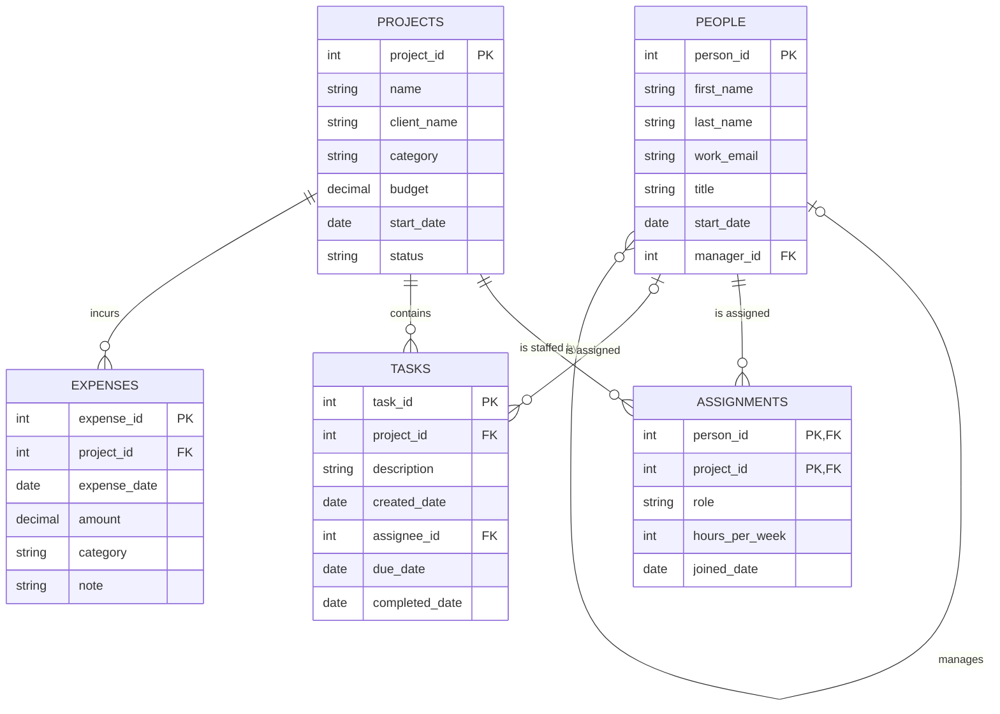

# Database Project · BabsonAI Labs

## 1. The Scenario

Scenario A. BabsonAI Labs: a startup founded by Babson students that builds AI tools for small businesses. It tracks its people, projects, staffing, tasks and spending in spreadsheets and chat threads. Its founders want to see who works on what, where the money goes, and who is overloaded. The as_of date is 2026-10-31, and the data covers the 12 months up to it.

## 2. The ERD

## 3. What One Row Means

- One row of `people` is one person who works at BabsonAI Labs.
- One row of `projects` is one project the company has planned, is running, has paused or has finished.
- One row of `assignments` is one person's commitment to one project: their role on it, the hours a week they give it, and the date they joined it.
- One row of `tasks` is one piece of work belonging to one project, assigned to at most one person.
- One row of `expenses` is one amount spent on one project.

## 4. Design Choices