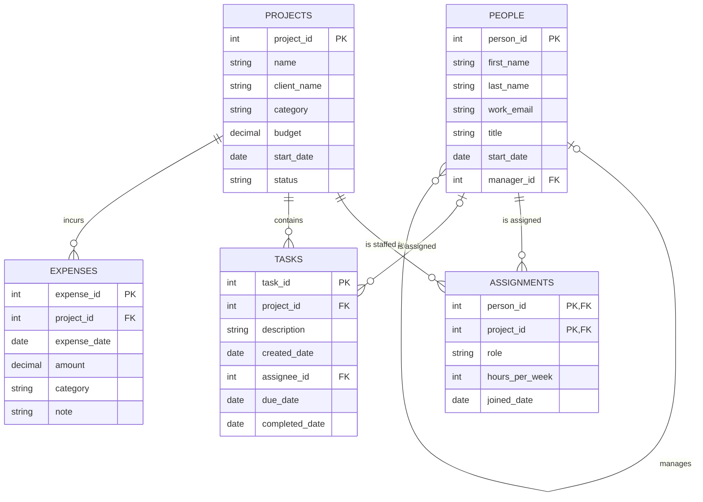

# Database Project · BabsonAI Labs

## 1. The Scenario

Scenario A. BabsonAI Labs: a startup founded by Babson students that builds AI tools for small businesses. It tracks its people, projects, staffing, tasks and spending in spreadsheets and chat threads. Its founders want to see who works on what, where the money goes, and who is overloaded. The as_of date is 2026-10-31, and the data covers the 12 months up to it.

## 2. The ERD

## 3. What One Row Means

- One row of `people` is one person who works at BabsonAI Labs.
- One row of `projects` is one project the company has planned, is running, has paused or has finished.
- One row of `assignments` is one person's commitment to one project: their role on it, the hours a week they give it, and the date they joined it.
- One row of `tasks` is one piece of work belonging to one project, assigned to at most one person.
- One row of `expenses` is one amount spent on one project.

## 4. Design Choices

**Keys.** 

The business already identifies people by their work email, but I chose to create a separate `person_id` because the scenario states that work emails can change when someone changes title. A primary key should never change, because `assignments` and `tasks` point at it. I also created a `project_id` because project names can change. For assignments, I used a combination of `person_id` and `project_id` as the primary key to prevent duplicate assignments of the same person to the same project.

**Optional relationships.** 

The two founders have no managers, new tasks may be unassigned (34 tasks in my data), and internal projects have no clients (projects 7, 8, 10 and 12). Similarly, projects 11 and 12 have no expenses, and a task's completion date remains empty until it is completed. 

**Rules the tables cannot enforce.** 

Some business rules require checking data across multiple tables. For example, a task's assignee must also be assigned to that task's project. A `CHECK` constraint cannot enforce this because it can only see one row of one table. Instead, I used a `LEFT JOIN` query under The Data in `build.py` to identify violations, which returned the two intentionally incorrect records (tasks 1 and 39); question 7 in Part B will list them. I also used a separate query to check that tasks were not assigned to people before their start dates, which returned no violations.

**Something I changed from the AI's suggestion.** 

One thing I changed was the working hours generated by AI. Its initial data had three people committing 72, 80 and 56 hours per week to active projects, which is unrealistic. This is because 80 hours a week is two full-time jobs. I had AI reduce and vary these figures to 46, 50 and 53 hours across their active projects (commit `db: generate data`). Although these totals exceed 40 hours, the business rule applies to each individual project commitment, not a person's combined hours, which is why question 3 asks for the people above 40.
