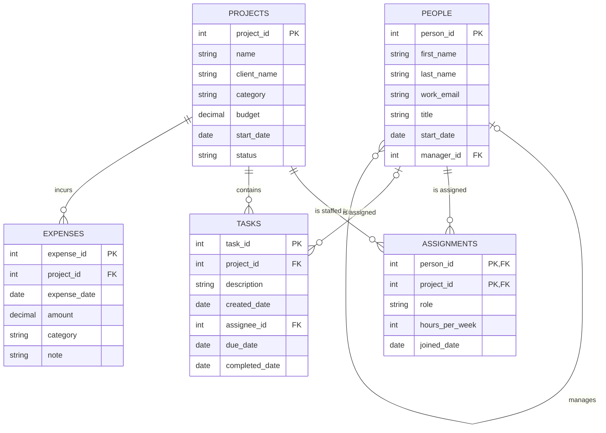

# Database Project · BabsonAI Labs

## 1. The Scenario

Scenario A, BabsonAI Labs. The as_of date is 2026-10-31; the data covers the 12 months up to it.

## 2. The ERD

## 3. What One Row Means

## 4. Design Choices